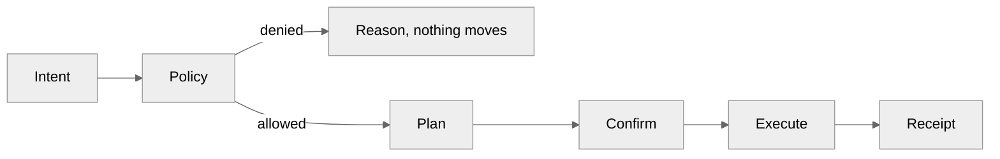
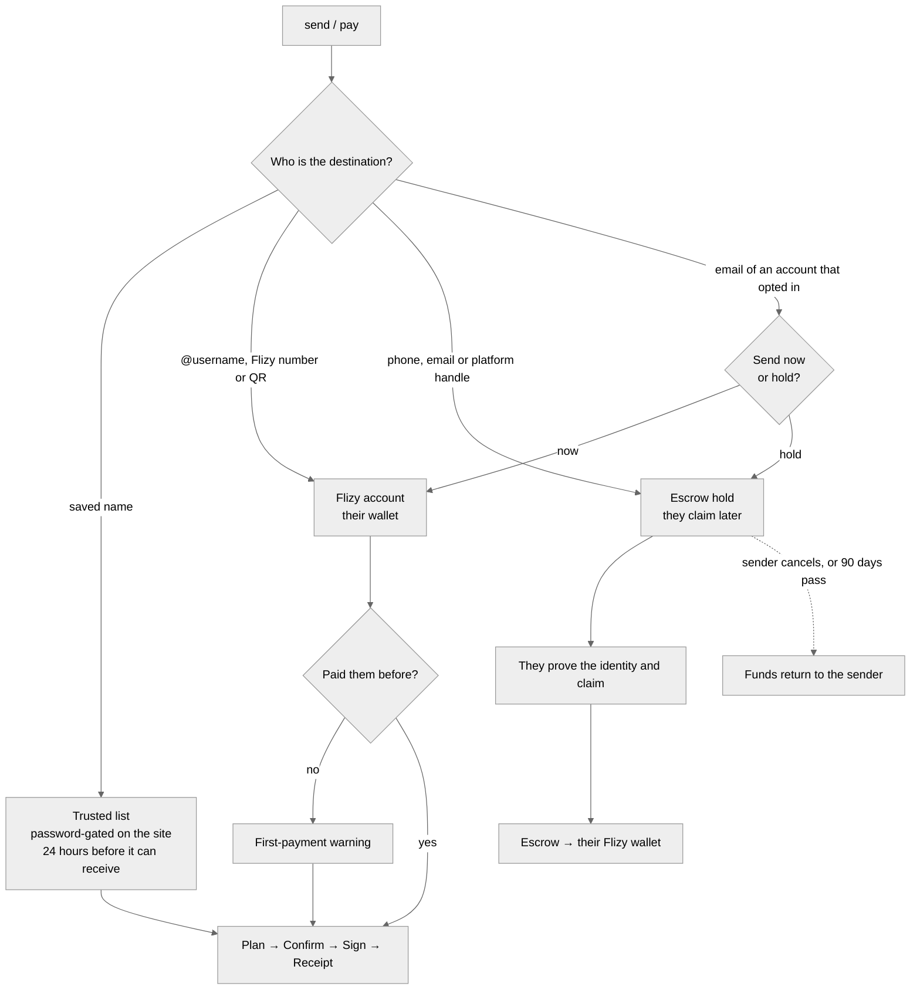
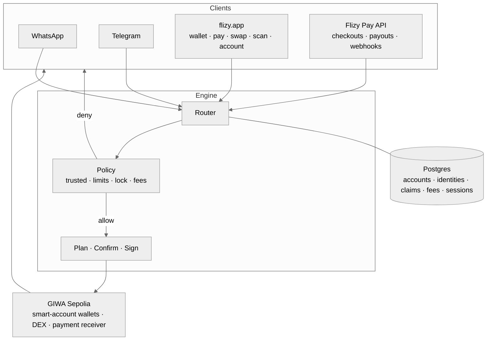
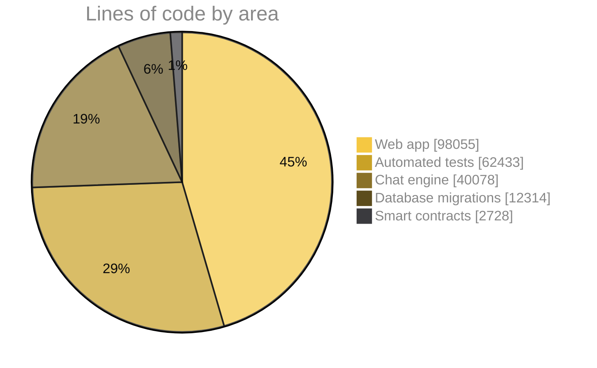
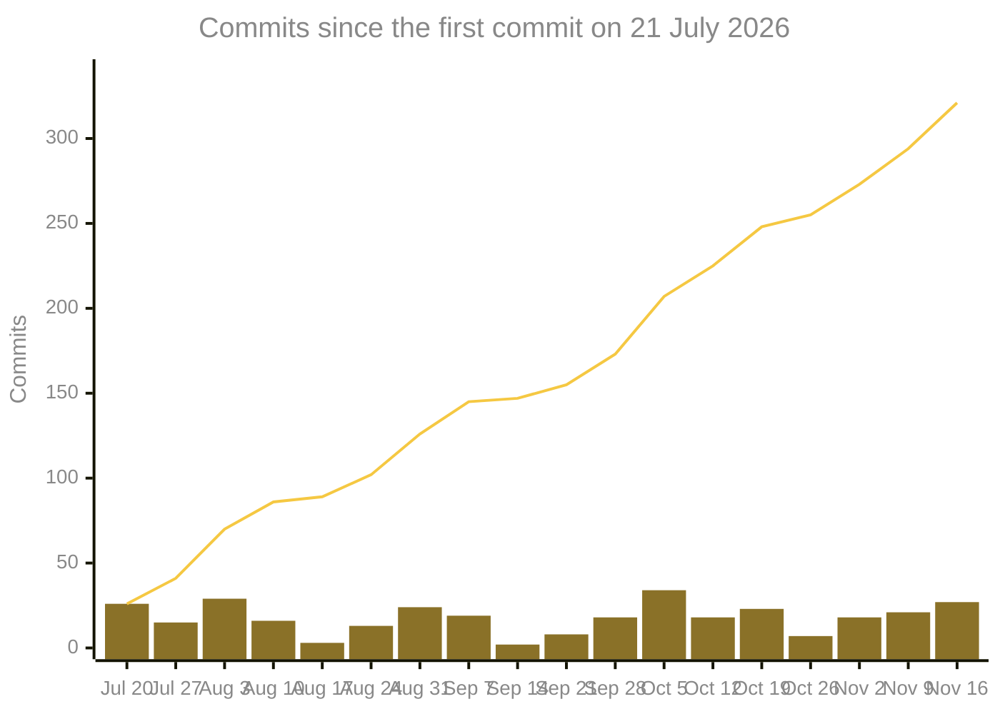

<p align="center">
  
</p>

<h1 align="center">Flizy</h1>

<p align="center">
  <strong>Pay anyone with a phone number, an email or a username.</strong><br />
  Payments, pay links, requests, receipts and a payments API, from WhatsApp, Telegram and the web,<br />
  where money can only move to destinations you approved.
</p>

<p align="center">
  <a href="https://flizy.app">flizy.app</a>
  ·
  <a href="https://flizy.app/how-it-works">How it works</a>
  ·
  <a href="https://flizy.app/docs">Security</a>
  ·
  <a href="https://x.com/Flizyapp">X</a>
  ·
  <a href="docs/ARCHITECTURE.md">Architecture</a>
  ·
  <a href="docs/OPERATIONS.md">Operations</a>
</p>

<p align="center">
  Live at <a href="https://flizy.app">flizy.app</a> · GIWA Sepolia testnet · 17 contracts deployed
</p>

---

## Contents

- [At a glance](#at-a-glance)
- [The problem](#the-problem)
- [The product](#the-product)
- [What is live today](#what-is-live-today)
- [Paused for now](#paused-for-now)
- [How money moves](#how-money-moves)
- [Business model](#business-model)
- [Security model](#security-model)
- [Architecture](#architecture)
- [Engineering](#engineering)
- [Contracts](#contracts)
- [Using Flizy](#using-flizy)
- [Roadmap](#roadmap)
- [Repository](#repository)

---

## At a glance

| | |
| --- | --- |
| **What** | A payments wallet you use from chat apps and the web, built so a single mistake cannot drain it |
| **Who** | People who already pay each other in WhatsApp and Telegram, small businesses that get paid there, and platforms that pay their users |
| **How** | One policy engine behind every channel. Chat can spend inside your rules; only the website, behind your password, can change them |
| **Where** | Live on [flizy.app](https://flizy.app), WhatsApp and Telegram, settling on GIWA Sepolia (testnet) |
| **Earns from** | A flat person-to-person payment fee, a merchant fee paid by businesses, and the swap protocol fee |
| **Built** | 165 API routes, 122 database migrations, 17 deployed contracts, 4,118 Node tests and 194 contract tests passing |

---

## The problem

Crypto payments still assume a laptop, a browser extension and a seed phrase. Most people
who would use them have none of those, and the ones who try lose money to one slip: a wrong
address pasted into a chat, an approval they did not read, a phone picked up while unlocked.

Wallets answer this with more warnings. Flizy answers it with a different default.

**Money can only move to a destination you approved earlier, from a device you already
trust.** Approving a new destination takes the website and your account password, and a
new destination cannot receive anything for its first 24 hours. Chat can spend inside
those rules. It can never rewrite them.

---

## The product

One account, one balance, one approved list, one history, reachable from three places.

| | WhatsApp | Telegram | flizy.app |
| --- | --- | --- | --- |
| Send to a saved name | `flizy send 0.01 to john` | `/send 0.01 to john` | Not on the site, by design |
| Pay a Flizy account | `flizy pay 5 tusd to @ludarep` | `/pay 5 tusd to @ludarep` | Pay link or QR |
| Send to a phone, email or handle | `flizy send 5 tusd to +234...` | `/send 5 tusd to ada@mail.com` | Claim a payment sent to you |
| Ask to be paid | `flizy request 50 tusd from @ada` | `/request 50 tusd from @ada` | Pay me: link, QR and a set amount |
| Swap | `flizy swap 0.1 ETH for FLZ` | `/swap 0.1 ETH for FLZ` | Swap, liquidity, limit orders |
| Confirm | reply `confirm` (the chat must be unlocked) | tap Confirm (the chat must be unlocked) | tap Confirm |
| Lock this device | `flizy lock` | `/lock` | sign out |

The site deliberately cannot send to an arbitrary address: funds leave only through a linked
chat app to a trusted destination, through a payment to a Flizy account, or through a claim.
Neither the PIN nor the password unlocks "any address".

Chat apps are thin clients on one engine. A message becomes an intent, the engine decides
whether money may move, and nothing executes without an explicit confirm. A new channel is
another adapter, not a second product.

---

## What is live today

### Payments

| Area | What a person can do | Status |
| --- | --- | --- |
| **Chat payments** | Send ETH, FLZ and tUSD from WhatsApp or Telegram, with a plan, the fee and a confirm for every move | Live |
| **Pay by identity** | Pay a Flizy `@username`, a 9-digit Flizy number, or a scanned QR. First payments are flagged | Live |
| **Claims** | Send to a phone, email, GitHub, Discord or Telegram identity. Funds wait in escrow until the owner proves that identity on a Flizy account. The sender can cancel until then, and an unclaimed chat claim returns to the sender by itself after 90 days | Live (X identities: linking paused) |
| **Claim emails** | Someone who is not on Flizy yet gets one email with the amount, the steps to receive it and one button to the claim page, then one reminder. Never a code or a password field; anyone can stop these emails with one click | Live |
| **Found by email** | Off by default. An account that turns it on can be paid directly by people who know one of its verified emails; everyone else's email sends are held as claims and reveal nothing about who has an account | Live |
| **Pay me** | A personal QR, Flizy number and pay link, printable. "Request payment" makes a link that opens with the amount, asset and note filled in | Live |
| **Requests** | `request 50 tusd from @ada for design work`. The payer sees who asks, for what, and a warning when they have never paid that person. At most 20 requests an hour per account | Live |
| **Receipts** | Every confirmed payment can be shared as a receipt page with a link preview. Chat sends reply with the link. Each person is named in full only if they chose to be named on Scan; otherwise the username is masked to five characters, such as l***p | Live |
| **Pay from any wallet** | Off by default. When the owner turns it on, someone without Flizy can pay their pay link from their own browser wallet through FlizyPaymentReceiver; Flizy records it only after reading the payment from the chain | Live |
| **Pay with ETH** | Pay a tUSD or FLZ amount with ETH in one swap that delivers to the payee. They receive at least the amount asked; the ETH counts toward the daily limit | Live |
| **Get paid** | Payments received over 30, 90 or 365 days, totals per asset, a CSV export, and refunds back through the pay page | Live |
| **Business accounts** | Turn on Business from Account after accepting the business terms. Customers pay the price and see no fee; the business receives the price less the merchant fee, and its history shows what arrived and what Flizy kept | Live |
| **Savings** | Set ETH aside from what can be spent. Savings cannot be sent, swapped or used to pay until it is moved back; every spend checks it on the server, including a payment approved later with a passkey | Live |
| **Gas top-up** | A wallet short of gas for a payment is topped up by Flizy, at most $0.50 per wallet a day, never from Savings | Live (testnet) |

### Flizy Pay API

For platforms that pay or collect from their users. Keys, webhooks and limits live under
Account, Developers, which appears once Flizy approves the platform.

| Area | What a platform can do | Status |
| --- | --- | --- |
| **Checkouts** | `POST /api/v1/payments` returns a `flizy.app/checkout/<id>` link. The customer pays from any wallet, from their Flizy wallet signed in, or in chat; the money goes straight to the platform's wallet and Flizy never holds it | Live |
| **Payouts** | `POST /api/v1/payouts` pays a Flizy user, a wallet, or a phone, email or platform identity as a claim. Payouts run through the same engine as a chat send, from the platform's own wallet, inside a daily allowance the platform signed with its passkey | Built; switched on per approved platform |
| **Webhooks** | Up to five signed https endpoints per platform, with an email notice for payouts above a set size | Live |

### Trading and tokens

| Area | What a person can do | Status |
| --- | --- | --- |
| **Swap and liquidity** | Trade ETH against FLZ, IZY, MAKI, tUSD or DCAT, and add liquidity to those pools, with fees and slippage shown before confirm | Live |
| **Ammora** | Trade tokens launched on Ammora, a separate swap venue on GIWA Sepolia, from chat and the site. Flizy pins each Ammora contract's code and turns the venue off if any of it changes | Live |
| **Listed tokens** | FLZ, IZY, MAKI and tUSD are verified; DCAT is listed. Each trades against an ETH pool Flizy seeded. Explore shows each pool's last 24 hours: a price line, the change and the number of trades. Only ETH, FLZ and tUSD can be sent on socials | Live |
| **Test dollars** | Flizy Test USD (tUSD), six decimals, fixed supply. Claim 100 a day from the faucet, then send, pay and request it like any other listed asset. It is test money and pegs to nothing | Live |
| **Limit orders** | Place an FLZ buy or sell at a price; a watcher fills it when the pool reaches it | Live |
| **Connect a wallet** | Sign in with MetaMask, Coinbase Wallet or any WalletConnect wallet and use Explore, token pages and Swap without a Flizy account; the wallet signs its own trades. A Flizy account can connect its own wallet as a second wallet to swap from, deposit from, and save as a trusted wallet | Live |
| **Copy trade** | Choose wallets to follow and set dollar rules | Settings only; nothing copies yet |

### Account

| Area | What a person can do | Status |
| --- | --- | --- |
| **Rewards** | Points on the fees you pay, when people you invite pay fees, and on your sales as a business. Shown in chat (`rewards`) and under Account | Live (points on testnet; nothing is paid out) |
| **Scan** | A public ledger of Flizy activity. Recipients show as the payment rail, and each person chooses whether their username appears | Live |
| **Starter pack** | A new account sees four steps on Home: link WhatsApp or Telegram, claim free test ETH, send a first 0.001 ETH from chat, and make a first swap. Each step ticks from the account's own activity | Live |
| **Account and security** | Trusted wallets, unlock PIN, daily ETH limit, password change that signs out other devices, chat links, platform identities, privacy controls | Live |
| **Passkey spending limits** | Add a passkey to your wallet and sign Flizy's daily limits with it. Chat payments inside them go out through that signed permission, with the cap enforced by contract. A payment over it is never sent until you approve that one payment with your passkey on flizy.app | Pilot. Flizy still holds the owner key; see below |

---

## Paused for now

Flizy is payments first. These are built and stay in the codebase, but are hidden from the
app and take no new activity until they are switched back on (`FEATURE_*` in
[`.env.example`](.env.example)):

- NFT marketplace (listing, buying, offers)
- NFT mints and collections, including the collection creator and Copy Mint
- Tasks, projects and the XP leaderboard
- Token posts, comments, likes and the watchlist
- Following people and the people directory (a profile link stays a pay page)

Nothing anyone owns is stranded: NFTs already held still show in the wallet and can be sent
from chat, open listings and offers can be cancelled, mint and sale credits can be withdrawn,
and open tasks can be closed and their winners paid.

---

## How money moves

Every path through Flizy is the same six steps. Chat, the site, the API and any future
channel all run through this spine.



The destination decides how it settles:



A claim is not a bearer link. Payout requires the signed-in account to prove the identity
the hold was addressed to (platform user id, verified phone or verified email), so a
lookalike handle cannot collect.

---

## Business model

Flizy earns a small, disclosed fee where value changes hands. Every fee is shown before the
person confirms, and the rates are server configuration, not hidden in code paths.

| Stream | Rate | Who pays |
| --- | --- | --- |
| **Person-to-person payments** | $0.02 up to $100, plus $0.01 for every started $100 above that, in the asset sent | The sender, on top of the amount. On a busy network the fee covers gas, and Flizy absorbs the difference up to a daily cap |
| **Merchant fee** | 0.5% of the price, at least $0.01 | The business, out of what it receives. The customer pays the price only |
| **API payouts** | The person-to-person fee on each payout | The platform, on top |
| **Swap protocol fee** | 0.30% by default, capped at 1% in contract | The trader, on top of the pool fee (`FlizyFeeRouter`) |

On testnet the fees are charged in test assets, and the rewards they earn are points with no
payout.

---

## Security model

| Control | What it does |
| --- | --- |
| **Approved destinations** | Sends by name reach the trusted list only. The list is edited on the site behind the account password, never from chat, and a new entry waits 24 hours before it can receive |
| **Plan, then confirm** | Every money action shows amount, destination, network and fees first. Nothing executes without a confirm |
| **No PIN per transaction on testnet** | Payments and limit orders go on Confirm. The guard is the session: a chat moves money only after it is unlocked with the PIN on flizy.app (30 minutes idle, 8 hours at most), and the site needs a signed-in session. One switch (`txPin` in `lib/tiers.js` and `web/lib/txPin.ts`) brings the per-transaction PIN back for mainnet, with quick send for small payments to people you already pay |
| **Trades that stay in the wallet** | Buying and selling FLZ, a listed token or an Ammora launch, and adding or removing liquidity, needs only Confirm on testnet: what you get lands back in your own wallet. Slippage is capped at 5% on the server, and the minimum you review is enforced. Tokens Flizy has not verified are not traded at all |
| **PIN and password, by risk** | The PIN unlocks chat. Account changes (trusted wallets, the PIN, the daily limit, email, username, linking, the password itself) ask for the account password. Each has its own lockout |
| **Per-channel lock** | Lock a chat app instantly. Unlocking takes the PIN on a one-time Flizy link; chat never takes the PIN or the password |
| **Limits** | A daily ETH cap per account, counted the same way in chat, on the site and at checkout |
| **Sessions** | Server-side sessions that can be revoked. Changing the password signs out every other device |
| **Privacy** | Scan never names who was paid, and each account decides whether its username shows there at all. A send to an email says the recipient is on Flizy only when they chose to be found |
| **API keys** | Per-platform keys with scopes, stored hashed, rotatable; payouts move only inside the allowance the platform signed with its passkey, and an unknown outcome is never retried blindly |

### Where the product actually is

Stated plainly, because it matters more than sounding finished.

- Flizy runs on **GIWA Sepolia, a testnet**. Do not treat it as production custody.
- Each account's wallet is a **smart account** (a MetaMask HybridDeleGator) that both the
  chat engine and the site spend from. It is still owned by a key the server derives, so
  **the current model is custodial**.
- **Passkey spending limits are live in a pilot.** A passkey on the wallet signs Flizy's
  daily limits; chat payments inside them are sent by a relayer through that signed
  permission, and a payment over them needs a passkey approval for that one payment. The
  limits are enforced by the contract, not by Flizy's server. See
  [docs/ARCHITECTURE.md](docs/ARCHITECTURE.md), with the on-chain measurements in
  [docs/DELEGATION-GIWA.md](docs/DELEGATION-GIWA.md) and
  [docs/PASSKEY-P256-GIWA.md](docs/PASSKEY-P256-GIWA.md).
- **That does not make Flizy non-custodial yet.** While Flizy's key is still the owner, it
  could act outside those limits. The last step moves ownership to the user's own wallet.
  It ships **before any mainnet launch**, and no wallet is described as non-custodial
  until it has and its owner can withdraw with Flizy's servers off.
- The approved-destination rule is enforced **in the policy layer** today. Moving it onto
  the account itself is the next security milestone.

---

## Architecture

Clients are adapters. Policy is the only money gate. The chain is infrastructure.



| Layer | Technology |
| --- | --- |
| Web | Next.js 15 (App Router), React 19, TypeScript, Tailwind CSS, on Vercel |
| Chat | WhatsApp and Telegram clients on a shared Node.js engine |
| Data | Supabase Postgres, schema in versioned SQL migrations, a build gate that refuses to deploy against a database missing any object the code needs |
| Chain | Solidity 0.8.24, Foundry, ethers; Uniswap V2 port, MetaMask delegation framework accounts, ERC-4337 UserOperations |
| Email | Transactional email from flizy.app for sign-in codes, security notices and claim notifications |

Implementation detail: [docs/ARCHITECTURE.md](docs/ARCHITECTURE.md).

---

## Engineering

Figures below are measured from this repository, not projected.

**Where the code is** (lines of code by area, excluding generated files, measured 19 November 2026):



About one line of test for every 2.5 lines of product code.

**Shipping momentum** (commits per week as bars, running total as the line, to 19 November 2026):



| Quality measure | Today |
| --- | --- |
| Automated tests | 4,118 Node tests and 194 Foundry contract tests, all passing |
| Test files | 290 Node, 10 Foundry |
| Production build | Type-checked and schema-gated on every build |
| Database | 122 idempotent migrations, each ending in a post-condition check that fails loudly |
| API surface | 165 routes. Every payment, limit order and checkout runs the server's step-up check, which on testnet passes on the signed-in session; every security setting re-checks the account password |
| Contracts | 17 deployed on GIWA Sepolia; 16 source verified as a full match, and the tUSD / WETH pair matches the verified pair bytecode |

---

## Contracts

**Network:** GIWA Sepolia · **Chain ID:** `91342` ·
**Explorer:** [sepolia-explorer.giwa.io](https://sepolia-explorer.giwa.io) ·
**Addresses:** [`deployments/giwa-sepolia.json`](deployments/giwa-sepolia.json)

| Contract | Purpose | Address |
| --- | --- | --- |
| **FlizyPaymentReceiver** | Lets an outside wallet pay a Flizy account or a checkout; forwards every payment to the payee in the same transaction, keeps nothing, no owner | [`0x1219...6FF1`](https://sepolia-explorer.giwa.io/address/0x12197866DdD74b0F37D2127AC5e2E69dFF6d6FF1) |
| **FlizyFeeRouter** | Swap protocol fee, 30 bps default, 100 bps maximum | [`0x6427...d9cC`](https://sepolia-explorer.giwa.io/address/0x6427fD0c13577847888B7E2d1A24C887bBEBd9cC) |
| **UniswapV2Router02** | Swaps and liquidity | [`0x4055...Faa0`](https://sepolia-explorer.giwa.io/address/0x4055413A4757e069bbCAc481639EF2814224Faa0) |
| **UniswapV2Factory** | Pair registry | [`0xBB1d...2BbF`](https://sepolia-explorer.giwa.io/address/0xBB1d2c582E455B448660A199097A54DF29162BbF) |
| **FLZ / WETH pair** | The ETH and FLZ pool | [`0xEC6E...8227`](https://sepolia-explorer.giwa.io/address/0xEC6Ebf4A7a3088EB22535C9F767B9Ab5845D8227) |
| **FLZ** | Test token, 100,000 supply, 18 decimals | [`0x308b...6BA6`](https://sepolia-explorer.giwa.io/address/0x308be8f71DA695f18E70D2243a446e1fD1566BA6) |
| **IZY** | Verified listed token (`FlizyToken`), 1,000,000 fixed supply, no owner | [`0x8CA7...4473`](https://sepolia-explorer.giwa.io/address/0x8CA7A8F78abC8dA471df82BE4F374e1661e34473) |
| **MAKI** | Verified listed token (`FlizyToken`), 1,000,000 fixed supply, no owner | [`0xd08d...693d`](https://sepolia-explorer.giwa.io/address/0xd08d83cdf19Db8CCd53Ed462034c8631De5F693d) |
| **IZY / WETH pair** | The ETH and IZY pool | [`0x2fC4...29Da`](https://sepolia-explorer.giwa.io/address/0x2fC40Df0c997310E07370cE547c56A0014B029Da) |
| **MAKI / WETH pair** | The ETH and MAKI pool | [`0xf9A9...33c5`](https://sepolia-explorer.giwa.io/address/0xf9A9FCF725bE455E9523a4846C649BC86d6533c5) |
| **tUSD** | Flizy Test USD (`FlizyTestUSD`), 1,000,000,000 fixed supply, 6 decimals, no owner | [`0x4F28...2446`](https://sepolia-explorer.giwa.io/address/0x4F28C18600c312Bfa8e8281D882e0EC306F82446) |
| **tUSD / WETH pair** | The ETH and tUSD pool | [`0xa207...4e50`](https://sepolia-explorer.giwa.io/address/0xa20728AF77F48b1cabeA5A95DE770eC405334e50) |
| **DCAT / WETH pair** | The ETH and DCAT pool | [`0x3083...1797`](https://sepolia-explorer.giwa.io/address/0x3083C7Aa86Bc20256439c102156E7fCbe7b91797) |
| **WETH9** | Wrapped ETH | [`0x3a13...6BDf`](https://sepolia-explorer.giwa.io/address/0x3a13399f2741122B63c7710B2A85346B97C6BFDf) |
| **FlizyMarketplace** | ERC-721 listings, offers and royalties; 2% fixed fee. Paused in the app | [`0x7e81...F64a`](https://sepolia-explorer.giwa.io/address/0x7e817b6c42C14C0eC90be76030f808eFB20dF64a) |
| **FlizyDrop** | Flizy-managed mints: phases, allowlist, limits; 2% fixed fee on paid mints. Paused in the app | [`0x8E5f...56cA`](https://sepolia-explorer.giwa.io/address/0x8E5f6205EF8bd47AB17EC03D529a3456EA8a56cA) |
| **FlizyCollectionFactory** | Creates Flizy-native collections owned by the creator. Paused in the app | [`0xFF60...0746`](https://sepolia-explorer.giwa.io/address/0xFF6035Bb2ef88Ff5F158C411a2337FF767270746) |

DCAT ([`0x58fB...Ffd1`](https://sepolia-explorer.giwa.io/address/0x58fB4D3DA82F5d610ad36E6e39e674C17B32Ffd1)) is a third-party
token and not counted above; Flizy lists it with a pool it seeded. Seed amounts and
transactions are under `listings` in the deployments file.

The DEX contracts are a Solidity 0.8 port of Uniswap V2, built with
`v0.8.24+commit.e11b9ed9`, optimizer on at 200 runs, EVM version cancun.

Also in the repository and not yet deployed: `FlizyLayeredCollection` and the factory's
`createWithMetadata`, for generated collections. `FlizyWallet.sol` is an early scaffold and
not the custody path.

Wallet accounts and passkey spending limits use unmodified MetaMask delegation-framework
v1.3.0 contracts, deployed by Flizy on GIWA Sepolia. Every enforcer's code matches the
release build byte for byte; the DelegationManager, the account implementation and its
P-256 library differ only where deployment writes addresses into the code (constructor
immutables and the library link), as each record explains. Addresses:
[`giwa-sepolia-delegation.json`](deployments/giwa-sepolia-delegation.json),
[`giwa-sepolia-period-enforcers.json`](deployments/giwa-sepolia-period-enforcers.json) and
[`giwa-sepolia-transfer-amount-enforcer.json`](deployments/giwa-sepolia-transfer-amount-enforcer.json).

---

## Using Flizy

1. **Sign up at [flizy.app](https://flizy.app).** Email, password, a one-time code, then a
   Flizy `@username`. The account comes with a wallet, a Pay me card and an invite link.
2. **Approve who you can pay.** Add a name and an address under Trusted wallets. It asks for
   your password, and the new address can receive after 24 hours.
3. **Link a chat app.** Generate a one-time code on the site and send it to Flizy on
   WhatsApp or Telegram.
4. **Pay from chat.** `flizy send 5 tusd to @ada`. Flizy replies with a plan and the fee;
   nothing moves until you confirm. You get a receipt with an explorer link.

### Chat commands

WhatsApp uses the `flizy` prefix. Telegram uses `/command` and also accepts the prefix.

| Command | Purpose |
| --- | --- |
| `help` | Command list |
| `link CODE` | Bind this chat to your account |
| `me` · `balance` · `deposit` · `history` | Account and wallet |
| `send AMOUNT [TOKEN] to name \| @user \| phone \| email \| @user on telegram` | Pay, or hold a claim |
| `claim` · `claims` · `cancel claims` | Receive a claim, see the ones you sent, or cancel them |
| `request AMOUNT [TOKEN] from name [for NOTE]` · `pay` · `requests` | Payment requests, in ETH, FLZ or tUSD |
| `swap AMOUNT ETH for FLZ` · `buy 100 IZY` · `sell 10 MAKI` · `price FLZ` | Trading FLZ and the listed tokens against ETH |
| `rewards` | Your reward points and the latest entries |
| `confirm` · `cancel` | Execute or drop the pending plan |
| `lock` · `unlock` (PIN entered on a Flizy link, never in chat) | Device control, per channel |

### On the site

| Route | Purpose |
| --- | --- |
| [/](https://flizy.app/) · [/how-it-works](https://flizy.app/how-it-works) · [/docs](https://flizy.app/docs) | Product, guides and security |
| [/dashboard](https://flizy.app/dashboard) | Home |
| [/dashboard/wallet](https://flizy.app/dashboard/wallet) | Balances, history, funding and Scan |
| [/dashboard/history](https://flizy.app/dashboard/history) · [/dashboard/received](https://flizy.app/dashboard/received) | Every payment and claim; payments received, totals and CSV |
| [/dashboard/swap](https://flizy.app/dashboard/swap) | Swap and add liquidity for any listed token against ETH; FLZ limit orders |
| [/dashboard/explore](https://flizy.app/dashboard/explore) | Listed tokens, their pools and Ammora launches |
| [/dashboard/account](https://flizy.app/dashboard/account) | Profile and privacy, Pay me, Business, Rewards, language, country, chat, platforms, trusted wallets, PIN, limits, security, and Developers for approved platforms |
| `/pay/[username]` · `/claim/[token]` · `/checkout/[id]` · `/r/[token]` · `/i/[username]` | Pay link, claim, checkout, receipt, personal invite |

Swap fee mechanics: [docs/swap-fees.md](docs/swap-fees.md). Trusted wallets in depth:
[docs/trusted-addresses.md](docs/trusted-addresses.md).

---

## Roadmap

| Horizon | Focus |
| --- | --- |
| **Now** | Chat payments with disclosed fees, identity claims with email notice and automatic return, Business accounts, the Flizy Pay API, rewards as points, swap and liquidity for the listed tokens and Ammora, limit orders, Scan with privacy controls, passkey spending limits in a pilot, all on GIWA Sepolia |
| **Next** | Send to an email or phone from the website. Move the approved-destination rule onto the account |
| **Before mainnet** | Move wallet ownership from Flizy's key to each user's own wallet, with an owner-only withdrawal that works with Flizy's servers off. Mainnet does not launch on server-owned wallets |
| **Then** | Copy trade execution, token-to-token pools and limit orders for listed tokens, then more EVM chains through the chain registry, on the same policy path. Paused features return when they serve the payments product |

---

## Repository

```text
index.js · telegram.js    chat clients (adapters) and background workers
lib/                      engine: router, policy, identity, claims, fees, rewards, swap, limit orders
web/                      Next.js site, dashboard, Flizy Pay API and other API routes
contracts/                Solidity sources, deploy scripts and Foundry tests
supabase/migrations/      database schema
deployments/              live contract addresses
docs/                     architecture, operations, fee mechanics
test/                     Node test suite
```

### Quickstart

```bash
npm install
cp .env.example .env      # fill in your values
npm start                 # WhatsApp client
npm run start:telegram    # Telegram client
npm test                  # Node suite
cd contracts && forge test
```

Configuration is documented in [`.env.example`](.env.example). Setup, deployment and
operations: [docs/OPERATIONS.md](docs/OPERATIONS.md).

---

## License and contact

Private product repository. Live at [flizy.app](https://flizy.app). On X:
[@Flizyapp](https://x.com/Flizyapp).
