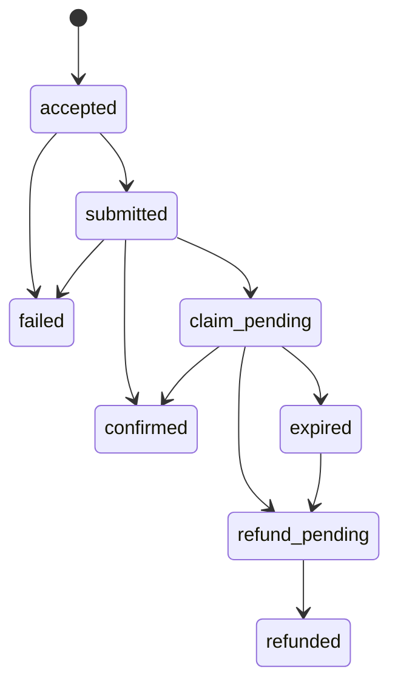

A payout moves an amount of one asset from your platform's wallet to one person. You create it, Flizy answers `202` with the payout in `accepted`, and sends it shortly after.

## Before your first payout

1. **A key with `payout`.** Flizy grants it per key after review.
2. **Assets enabled.** Flizy enables each asset for your platform, with the most one payout may move and the most per day.
3. **A payout allowance.** On the Developers page, sign the allowance with your account's passkey. It lets Flizy's relayer spend up to the daily maximum of each enabled asset from your wallet, for 30 days, and the chain enforces it. Payouts are only ever sent through it. Sign it again before it ends.
4. **Funds.** Your wallet must hold the amounts plus a small ETH reserve for gas.

`GET /me` answers `payouts_enabled: true` once payouts are switched on and the key has `payout`.

## Who you can pay

| `recipient.type` | `value` | Paid as |
|---|---|---|
| `username` | A Flizy username, e.g. `ada` | Directly to their Flizy wallet |
| `address` | A 0x address | Directly to that address |
| `phone` | International format, e.g. `+2348012345678` | A claim |
| `email` | An email address | A claim |
| `telegram`, `discord`, `github` | The numeric user id, never a handle | A claim |

A **claim** holds the money in Flizy's escrow until the person collects it with the claim link, signing in to Flizy with that phone, email or account. The payout's `claim.url` carries the link once the claim is held: deliver it to the person yourself. If they already have a Flizy account with that phone, email or chat account, Flizy also tells them in their chats.

Every valid request gets the same `202`, whoever the recipient is. Whether a username exists, or a phone or email belongs to a Flizy member, is never revealed by the answer. A username that cannot be paid fails afterwards with `recipient_not_payable`.

## States



| State | Meaning |
|---|---|
| `accepted` | Recorded. Not sent yet. |
| `queued` | Reserved for a payout waiting its turn. Today payouts go from `accepted` straight to `submitted`. |
| `submitted` | The transaction is on its way. `tx_hash` is set. |
| `confirmed` | **Completed.** The money reached the person, or they collected the claim. |
| `claim_pending` | The claim is held in escrow. `claim.url` is set. |
| `expired` | Nobody claimed it in time. It is refunded next. |
| `refund_pending` | The claim is being refunded to your wallet. |
| `refunded` | **Completed.** The money came back. `claim.refund_tx_hash` is set. |
| `failed` | Not sent, or ran on chain and moved nothing. `error_code` says why. Final. |

`completed` is `true` only in `confirmed` and `refunded`. Never treat `accepted` or `submitted` as paid.

## Claim expiry

A claim stays claimable for your platform's default number of days, shown on the Developers page. Set `claim_expiry_days` on a claim payout to choose, up to your platform's maximum. When it runs out, the claim is refunded to your wallet: `expired`, then `refund_pending`, then `refunded`.

## Cancelling

`POST /payouts/{id}/cancel`:

- **`accepted`**: it becomes `failed` with `error_code` `cancelled`. Nothing was sent.
- **`claim_pending`**: the cancel is recorded and the claim is refunded: `refund_pending`, then `refunded`. If the person collects it first, the claim is theirs and the payout becomes `confirmed`.
- **`expired`, `refund_pending`, `refunded`**: already coming back; answered as they are.
- **Anything else**: `409`. A payout being sent or already sent cannot be called back.

Your account's owner can also cancel an unclaimed claim from chat; the payout then becomes `refund_pending` and `refunded`.

## Example: pay by email

<CodeGroup>
```javascript JavaScript
const res = await fetch('https://flizy.app/api/v1/payouts', {
  method: 'POST',
  headers: {
    Authorization: `Bearer ${process.env.FLIZY_API_KEY}`,
    'Content-Type': 'application/json',
    'Idempotency-Key': 'bonus-2026-11-ada',
  },
  body: JSON.stringify({
    amount: '5',
    asset: 'tUSD',
    recipient: { type: 'email', value: 'ada@example.com' },
    claim_expiry_days: 14,
    reference: 'november bonus',
  }),
});
const payout = await res.json();

// Later, once the payout.claim_pending webhook arrives:
const now = await fetch(`https://flizy.app/api/v1/payouts/${payout.id}`, {
  headers: { Authorization: `Bearer ${process.env.FLIZY_API_KEY}` },
}).then((r) => r.json());
console.log(now.state, now.claim.url); // send the link to Ada
```

```python Python
import os
import requests

API = "https://flizy.app/api/v1"
HEADERS = {"Authorization": f"Bearer {os.environ['FLIZY_API_KEY']}"}

payout = requests.post(
    f"{API}/payouts",
    headers={**HEADERS, "Idempotency-Key": "bonus-2026-11-ada"},
    json={
        "amount": "5",
        "asset": "tUSD",
        "recipient": {"type": "email", "value": "ada@example.com"},
        "claim_expiry_days": 14,
        "reference": "november bonus",
    },
    timeout=30,
).json()

# Later, once the payout.claim_pending webhook arrives:
now = requests.get(f"{API}/payouts/{payout['id']}", headers=HEADERS, timeout=30).json()
print(now["state"], now["claim"]["url"])  # send the link to Ada
```
</CodeGroup>

## Listing

`GET /payouts` lists newest first, `limit` 1 to 100 (default 20). When `has_more` is true, pass the last item's `created_at` as `before` for the next page.
